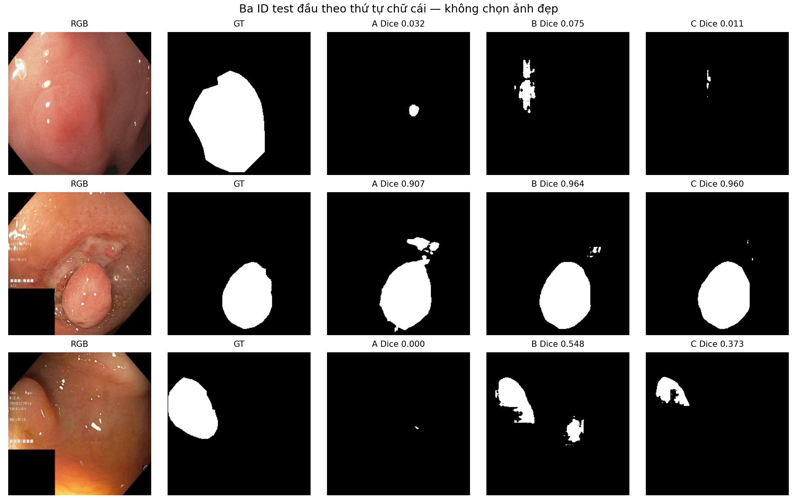

# Phân đoạn polyp với U-Net và U-Net++

Đồ án Deep Learning · Nhóm 06

So sánh U-Net, U-Net++ và U-Net++ có giám sát sâu trên Kvasir-SEG. Mỗi mô hình nhận ảnh nội soi RGB và dự đoán mặt nạ polyp theo từng pixel.



## Kết quả trên 150 ảnh test

| Mô hình | Dice | IoU | Precision | Recall |
| --- | ---: | ---: | ---: | ---: |
| A · U-Net | 0,6014 | 0,4873 | 0,6852 | 0,6267 |
| B · U-Net++ | 0,6682 | 0,5421 | 0,7062 | 0,7370 |
| C · U-Net++ có giám sát sâu | **0,7390** | **0,6304** | **0,7779** | **0,8007** |

Cả ba dùng chung split **700 train / 150 validation / 150 test**, ảnh **256×256** và seed **42**. Checkpoint được chọn theo Dice validation. B và C dùng head cuối khi đánh giá. Điểm là trung bình theo ảnh. C dẫn đầu trên toàn tập test ở lượt này. Cần nhiều seed và dữ liệu ngoài để đánh giá mức độ khái quát.

[Bảng kết quả gốc](results/comparison/comparison.csv) · [Minh chứng tái lập](results/report_figures/notebook_20261115/execution_summary.json) · [Báo cáo Word trong repo](reports/BaoCao_DeepLearning_Nhom_06.docx)

## Chạy notebook

Repo chứa sẵn 1.000 cặp ảnh và mask. Trọng số được tải từ GitHub Release và kiểm tra SHA-256.

Trên Windows, mở PowerShell và dùng Python 3.12. Thay `--device cpu` bằng `--device cuda` nếu máy dùng GPU NVIDIA tương thích CUDA 12.8.

```powershell
git clone https://github.com/trangkhanh-ai/unet-vs-unetplusplus-polyp.git
cd unet-vs-unetplusplus-polyp
py -3.12 scripts/setup_environment.py --device cpu
$Python = './.venv/Scripts/python.exe'
& $Python -X utf8 -m pip install -r requirements-notebook.txt
& $Python -X utf8 scripts/prepare_project.py
```

Trên Linux/macOS, dùng `python3.12` cho bước tạo môi trường và `./.venv/bin/python` cho các lệnh Python tiếp theo.

1. Mở repo trong VS Code với extension Jupyter. Chọn Python trong `.venv` làm kernel.
2. Mở [notebook đồ án](notebooks/DoAn_Nhom06_DayDu.ipynb). Ở cell đầu, đặt `TRAIN_FROM_SCRATCH = False` để đánh giá checkpoint báo cáo. Chọn **Restart Kernel → Run All**.
3. Để huấn luyện mới, đặt `TRAIN_FROM_SCRATCH = True` và `REUSE_COMPLETED_RUN = None`. Nếu đã có lượt notebook hoàn tất cùng cấu hình, điền tên thư mục của lượt đó vào `REUSE_COMPLETED_RUN` để đọc lại. Kết quả từng lượt nằm ở `results/notebook_<thời gian>/`.
4. Mở [notebook giao diện và biểu đồ](notebooks/GiaoDien_Va_BieuDo.ipynb) để chạy kiểm tra Streamlit và tạo lại biểu đồ báo cáo. Notebook tự dừng server sau khi kiểm tra.
5. Mở [notebook thí nghiệm bổ sung](notebooks/ThiNghiemBoSung_Nhom06.ipynb) để tái lập sàng lọc ảnh tương tự và đo các nhánh cắt tỉa U-Net++.

Để mở ứng dụng và thử ảnh nội soi trong trình duyệt, chạy lệnh sau rồi mở [demo cục bộ](http://127.0.0.1:8501).

```powershell
& $Python -X utf8 CacFileSource.py demo --port 8501
```

## Notebook theo thành viên

| Thành viên | Phần phụ trách | Notebook |
| --- | --- | --- |
| Nguyễn Bảo Duy | U-Net, khóa checkpoint và tích hợp | [U-Net và tích hợp](members/duy/works_done/Duy_UNet_Va_Tich_Hop.ipynb) |
| Trang Mai Quốc Khánh | Manifest, tiền xử lý và augmentation | [Dữ liệu và augmentation](members/khanh/works_done/Khanh_Du_Lieu_Va_Augmentation.ipynb) |
| Nguyễn Hoàng Phúc | Nested dense skip và deep supervision | [U-Net++ và giám sát sâu](members/phuc/works_done/Phuc_UNetPlusPlus_Va_Deep_Supervision.ipynb) |
| Lê Trần Nhật Huy | Loss, lịch sử train và checkpoint | [Loss và huấn luyện](members/huy/works_done/Huy_Loss_Va_Huan_Luyen.ipynb) |
| Nguyễn Đức Trí | Metric, phân tích lỗi và dự đoán | [Đánh giá và dự đoán](members/tri/works_done/Tri_Danh_Gia_Va_Du_Doan.ipynb) |

Notebook đồ án chứa các class và hàm cốt lõi để đọc từ dữ liệu đến dự đoán. Năm notebook theo thành viên minh họa từng phần, gọi module tương ứng và đọc minh chứng đã lưu. Hai sơ đồ có nhãn theo đúng cấu hình nhóm nằm ở [U-Net](results/report_figures/notebook_20261115/unet_chu_thich.png) và [U-Net++](results/report_figures/notebook_20261115/unetplusplus_chu_thich.png).

## Kiểm tra và đóng gói

### Thí nghiệm bổ sung

Trong [notebook](notebooks/ThiNghiemBoSung_Nhom06.ipynb), chọn **Restart Kernel → Run All**. Đặt `RUN_EXPERIMENTS = True` để chạy cả hai phép thử và ghi vào thư mục riêng dưới `results/`. Đặt `False` để xem bảng, ảnh minh họa và biểu đồ từ minh chứng của báo cáo. `DEVICE = "auto"` ưu tiên CUDA khi khả dụng.

Sau bước chuẩn bị môi trường và checkpoint ở trên, chạy hai lệnh dưới đây từ gốc repo. Chọn thư mục đầu ra mới cho mỗi lượt. Dùng `--device cpu` nếu chỉ có CPU.

```powershell
& $Python -X utf8 scripts/audit_split_similarity.py --output results/similarity_new
& $Python -X utf8 scripts/benchmark_pruned_heads.py --output results/pruning_new --device cuda
```

- **Sàng lọc ảnh tương tự.** So 232.500 cặp ảnh khác tập bằng perceptual hash và đánh dấu 17 cặp ứng viên. Tính lại Dice khi tạm loại 6 ảnh test bị đánh dấu vẫn cho cùng thứ hạng A/B/C. Xem [danh sách cặp](results/report_figures/extension_20261123/similarity/similarity_candidates.csv) và [bảng độ nhạy](results/report_figures/extension_20261123/similarity/similarity_sensitivity.csv). Phép sàng lọc dùng thông tin ở cấp ảnh.
- **Cắt tỉa U-Net++.** Dùng checkpoint C để chạy các mạng con L1–L4 và đo từng nhánh. L3 đạt Dice test 0,7268 và 10,71 ms/ảnh, so với 0,7390 và 16,88 ms/ảnh của L4. Đây là thời gian forward FP32, batch 8 trên RTX 5060 Laptop GPU. Xem [bảng đo](results/report_figures/extension_20261123/pruning/pruning_summary.csv) và [cấu hình phép đo](results/report_figures/extension_20261123/pruning/pruning_summary.json).

### Kiểm tra dự án

```powershell
& $Python -X utf8 CacFileSource.py check
& $Python -X utf8 CacFileSource.py compare --device auto
& $Python -X utf8 scripts/build_submission.py --output reports/1.ChuongTrinh.zip
```

`check` chạy kiểm tra code. `compare` đánh giá lại cùng tập test và xuất CSV, mask, biểu đồ vào thư mục mới. Lệnh đóng gói tạo ZIP gồm code, dữ liệu và checkpoint tham chiếu.

| Thư mục | Nội dung |
| --- | --- |
| `notebooks/` | Luồng đồ án và giao diện |
| `members/*/works_done/` | Module Python và notebook của từng người |
| `configs/` | Cấu hình A/B/C, manifest hash và khóa checkpoint |
| `results/` | Metric, hình và minh chứng thực nghiệm |

Tài liệu gốc · [U-Net](https://arxiv.org/abs/1505.04597) · [U-Net++](https://arxiv.org/abs/1807.10165) · [Kvasir-SEG](https://arxiv.org/abs/1911.07069)
