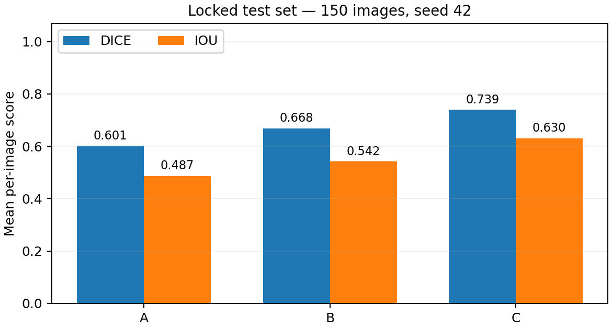
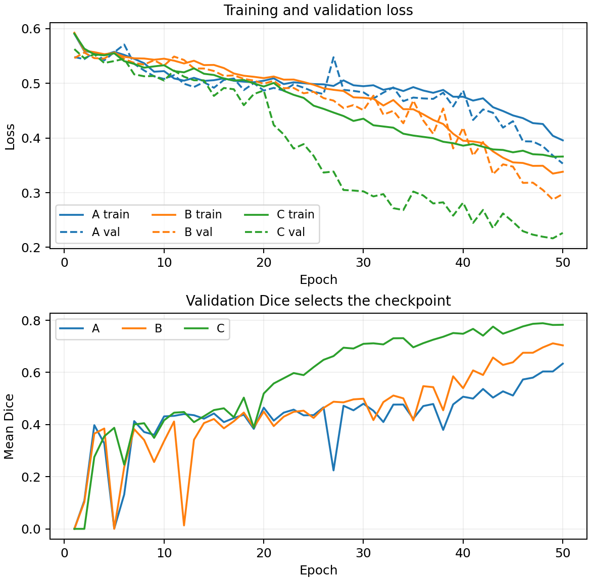
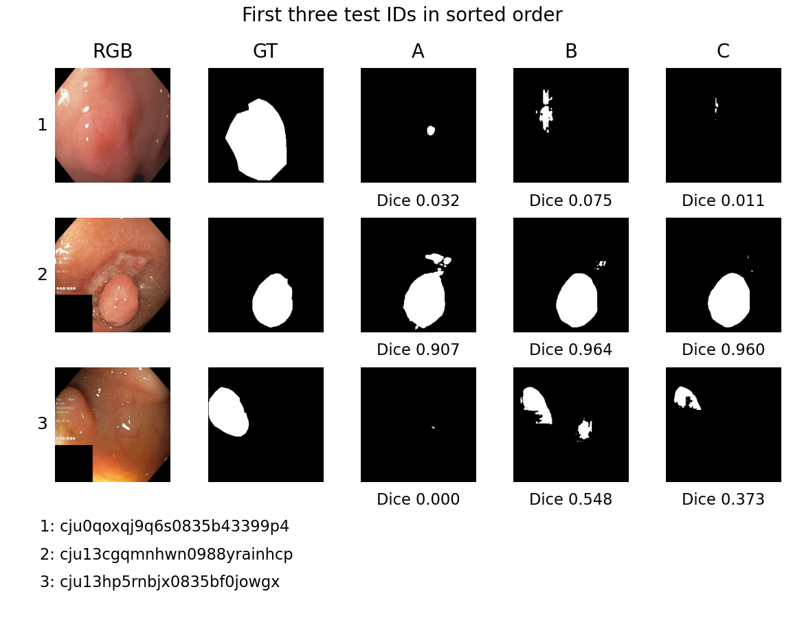
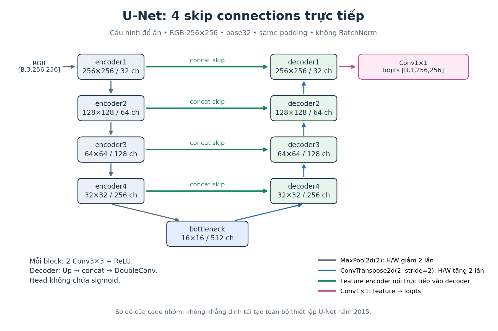
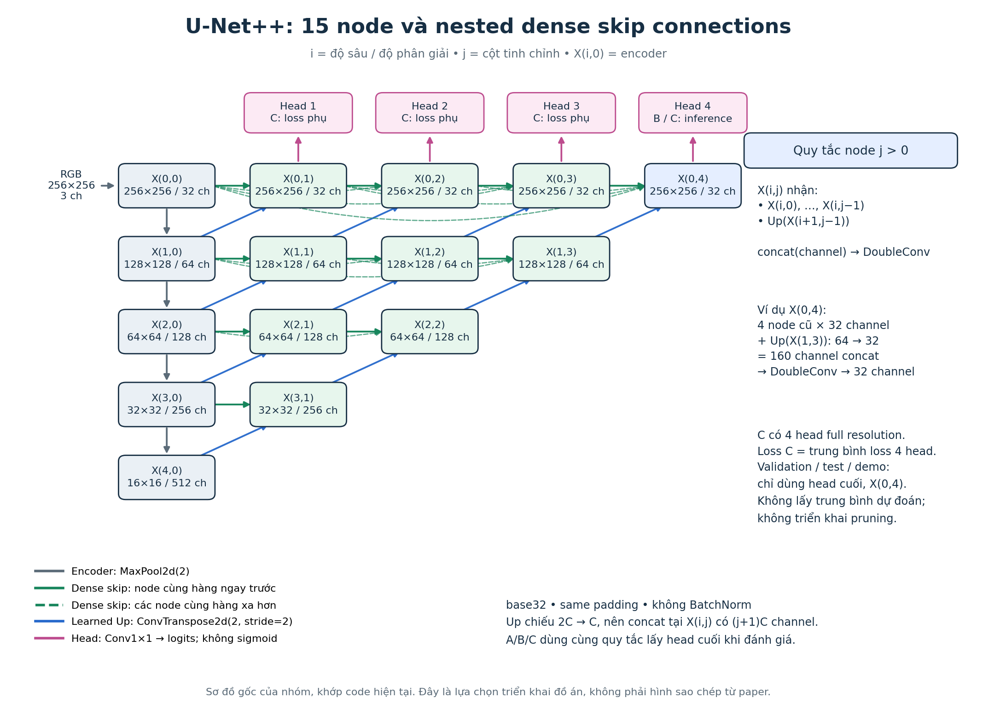

# Phân đoạn polyp: U-Net và U-Net++

Đồ án môn Deep Learning, đề tài 06: nghiên cứu kiến trúc U-Net++, **nested dense skip connections**, phân đoạn polyp trên **Kvasir-SEG** và so sánh với U-Net thông thường.

Bản tích hợp do **Nguyễn Bảo Duy — dzyuu1612** bàn giao, có AI hỗ trợ triển khai. Các folder giữ phân công của nhóm; từng thành viên cần tự đọc, chạy và xác nhận phần mình.

## Mục lục

1. [Kết quả thật và hình ảnh](#1-kết-quả-thật-và-hình-ảnh)
2. [Chạy nhanh trên máy mới](#2-chạy-nhanh-trên-máy-mới)
3. [Năm người và cách ghép code](#3-năm-người-và-cách-ghép-code)
4. [Hiểu bài toán và tensor](#4-hiểu-bài-toán-và-tensor)
5. [U-Net: từng tầng đi đâu](#5-u-net-từng-tầng-đi-đâu)
6. [U-Net++: nested dense skip](#6-u-net-nested-dense-skip)
7. [Deep supervision, loss và gradient](#7-deep-supervision-loss-và-gradient)
8. [Protocol so sánh](#8-protocol-so-sánh)
9. [Chạy lại toàn bộ kết quả bằng checkpoint](#9-chạy-lại-toàn-bộ-kết-quả-bằng-checkpoint)
10. [Huấn luyện lại từ đầu](#10-huấn-luyện-lại-từ-đầu)
11. [Tự vẽ các hình chi tiết](#11-tự-vẽ-các-hình-chi-tiết)
12. [Checkpoint, resume và tái lập](#12-checkpoint-resume-và-tái-lập)
13. [Học và bảo vệ đồ án](#13-học-và-bảo-vệ-đồ-án)
14. [Lỗi thường gặp](#14-lỗi-thường-gặp)
15. [Tài liệu và repo tham khảo](#15-tài-liệu-và-repo-tham-khảo)

## 1. Kết quả thật và hình ảnh

Cả A/B/C đã chạy **50 epoch**, chọn best bằng validation, khóa checkpoint trước khi đánh giá trên **cùng 150 ảnh test**.

| Mô hình | Dice | IoU | Precision | Recall | Best epoch | Tham số |
|---|---:|---:|---:|---:|---:|---:|
| A — U-Net | 0.6014 | 0.4873 | 0.6852 | 0.6267 | 50 | 7,760,097 |
| B — U-Net++ | 0.6682 | 0.5421 | 0.7062 | 0.7370 | 49 | 9,042,177 |
| C — U-Net++ có deep supervision | 0.7390 | 0.6304 | 0.7779 | 0.8007 | 48 | 9,042,276 |

Nguồn số chưa làm tròn: [comparison.csv](results/comparison/comparison.csv), [comparison.json](results/comparison/comparison.json). Có [CSV từng ảnh](results/comparison/paired_per_image.csv), [phân nhóm diện tích](results/comparison/comparison_by_size.csv) và toàn bộ mask trong `results/A_test`, `B_test`, `C_test`.

**C cao nhất trong một seed 42 và một split này.** Một seed chưa chứng minh ưu thế ổn định. A/B khác số tham số nên khác biệt không cô lập hoàn toàn tác động của skip connection.





Train loss C là mean bốn head; val loss C dùng head cuối. Train có augmentation, validation không có. Không diễn giải khoảng cách hai đường chỉ bằng overfitting.



Ba test ID đầu theo thứ tự sắp xếp, có Dice từng ảnh. Hình giữ cả ca thất bại; C không thắng trên mọi ảnh. `results/comparison` còn có ví dụ chọn theo delta/điểm thấp để phân tích lỗi.

Audit xác nhận **1.000 cặp ảnh/mask** và **48/48 kiểm tra kỹ thuật đạt**. Qua kiểm tra code không đồng nghĩa model phân đoạn tốt; điểm model nằm ở bảng test phía trên.

## 2. Chạy nhanh trên máy mới

### 2.1. Clone đúng bản code

Cần Git và **Python 3.12**. Bản tích hợp nằm ở nhánh sau; khi nhóm merge vào main có thể clone main.

```powershell
git clone --branch codex/full-polyp-project https://github.com/trangkhanh-ai/unet-vs-unetplusplus-polyp.git
Set-Location -LiteralPath 'unet-vs-unetplusplus-polyp'
```

Dữ liệu Kvasir-SEG đã có trong lịch sử repo: `Kvasir-SEG/images` và `Kvasir-SEG/masks`. Manifest là `members/khanh/works_done/dataset_splits.csv`. Nếu chỉ nhận source ZIP, cần chép/tải dữ liệu theo [nguồn chính thức](https://datasets.simula.no/kvasir-seg/), giữ nguyên ID và vị trí. **Không tự chia lại CSV khi dùng checkpoint đã có.**

### 2.2. Cài môi trường — Windows có NVIDIA

```powershell
py -3.12 scripts/setup_environment.py --device cuda --visualizations
$PolypPython = './.venv/Scripts/python.exe'
& $PolypPython -X utf8 -B project.py --help
```

Script tạo `.venv`, cài Torch **2.11.0+cu128**, requirements và công cụ vẽ. CUDA wheel có runtime cần thiết; vẫn cần driver NVIDIA phù hợp. Với RTX 5060 Laptop của Duy, môi trường này đã chạy thật.

### 2.3. Máy CPU

```powershell
py -3.12 scripts/setup_environment.py --device cpu
$PolypPython = './.venv/Scripts/python.exe'
```

CPU chạy inference/test được nhưng chậm hơn; không cần huấn luyện lại để xem kết quả.

Linux/macOS dùng `python3.12` thay `py -3.12`; Python môi trường nằm ở `./.venv/bin/python`.

macOS dùng `--device cpu`; script cài `torch==2.11.0` từ PyPI vì wheel macOS không dùng hậu tố `+cpu` của Windows/Linux. Pipeline này không chọn MPS hoặc CUDA trên Mac.

### 2.4. Tải mô hình đã train và mở demo

```powershell
& $PolypPython -X utf8 -B scripts/prepare_project.py
& './scripts/chay_demo.ps1'
```

Mở **http://127.0.0.1:8501**, chọn A/B/C, tải ảnh rồi bấm **Phân đoạn ảnh**. Có mask và overlay để tải PNG.

Ba `best.pt` được tải từ [GitHub Release duy-polyp-v1](https://github.com/trangkhanh-ai/unet-vs-unetplusplus-polyp/releases/tag/duy-polyp-v1). Mỗi tệp được kiểm tra kích thước và SHA256 theo [pretrained_release.json](configs/pretrained_release.json). File lớn nằm ở Release, không nằm trong Git source.

Muốn lấy thêm `last.pt` để resume:

```powershell
& $PolypPython -X utf8 -B scripts/prepare_project.py --include-last
```

Nếu cổng đã dùng: `& './scripts/chay_demo.ps1' -Port 8502`. Linux/macOS chạy trực tiếp:

```bash
./.venv/bin/python -X utf8 -B project.py demo --server.port 8501
```

### 2.5. Máy Duy đã cài từ trước

Nếu chưa tạo `.venv` trong repo, dùng môi trường workspace đã chạy thí nghiệm:

```powershell
$PolypPython = '../.venv-polyp/Scripts/python.exe'
& $PolypPython -X utf8 -B scripts/prepare_project.py
& './scripts/chay_demo.ps1'
```

Script demo ưu tiên `.venv` trong repo rồi mới dùng môi trường workspace.

## 3. Năm người và cách ghép code

| Người | Folder | Mã chính cần đọc | Trách nhiệm |
|---|---|---|---|
| Duy | `members/duy/works_done` | `unet.py`, `model_factory.py`, `lock_protocol.py` | U-Net, giao diện, khóa thực nghiệm, tích hợp, tổng hợp |
| Khánh | `members/khanh/works_done` | `dataset.py`, `audit_data.py` | Manifest, RGB/mask, augmentation/seed, kiểm tra dữ liệu |
| Phúc | `members/phuc/works_done` | `unetplusplus.py`, `architecture_figures.py` | U-Net++, node/dense skip, bốn head, sơ đồ |
| Huy | `members/huy/works_done` | `losses.py`, `run_utils.py`, `training.py`, `train.py` | Một trainer A/B/C, loss, checkpoint/resume |
| Trí | `members/tri/works_done` | `metrics.py`, `evaluate.py`, `compare.py`, `predict.py`, `demo.py` | Metric, evaluation, bảng/ảnh lỗi, demo |

`project.py` là điểm chạy chung; import phần từng người, không gom nghiệp vụ vào một file.

```text
Manifest + Dataset (Khánh)
        ↓
Factory → U-Net (Duy) hoặc U-Net++ (Phúc)
        ↓
Loss + trainer (Huy), dùng metric chung (Trí)
        ↓
Validation chọn best → Duy khóa checkpoint/config
        ↓
Evaluator/compare/predict/demo (Trí)
        ↓
Bảng, hình, báo cáo và giải thích của cả nhóm
```

**Giao diện đã chốt:**

- Train/validation loader trả `(images, masks)`; evaluation có `image_id`.
- Images float32 `[N,3,256,256]`, RGB/255; masks float32 `[N,1,256,256]`, chỉ 0/1.
- A/B forward trả một Tensor logits; C trả list bốn Tensor cùng shape theo thứ tự head 1→4.
- Model không sigmoid. Loss nhận logits; evaluator sigmoid rồi threshold 0.5.
- Trainer/evaluator import cùng metric và model factory.
- H/W input là bội của 16, ít nhất 16. Demo resize ảnh mới đúng preprocessing checkpoint.

Các công cụ intake/diagnostic cũ trong folder Huy/Duy giữ để truy nguyên; quy trình chính dùng các lệnh `project.py` trong README này.

## 4. Hiểu bài toán và tensor

Đây là **binary semantic segmentation**: mỗi pixel là polyp hoặc nền. Không phải chỉ phân loại cả ảnh có polyp, cũng không thay mask bằng bounding box.

`NCHW`: N là số ảnh/batch, C là channel, H/W là cao/rộng. Feature32/64/128 channel là đặc trưng học được, không phải 32/64/128 màu.

Đọc ảnh bằng byte + OpenCV để hỗ trợ đường dẫn Unicode. RGB resize linear, chia255. Mask JPEG đọc grayscale, pixel>127 thành1, sau đó resize **nearest** để không tạo nhãn phân số.

Train có biến đổi hình học đồng bộ ảnh/mask; ColorJitter chỉ đổi ảnh. Val/test chỉ resize và normalize. Albumentations có RNG riêng; Dataset và sampler reset theo seed+epoch để ba model gặp cùng thứ tự/chuỗi augmentation.

## 5. U-Net: từng tầng đi đâu



| Tầng | Channel | H×W |
|---|---:|---|
| Input | 3 | 256×256 |
| Encoder1 | 32 | 256×256 |
| Encoder2 | 64 | 128×128 |
| Encoder3 | 128 | 64×64 |
| Encoder4 | 256 | 32×32 |
| Bottleneck | 512 | 16×16 |
| Decoder4 | 256 | 32×32 |
| Decoder3 | 128 | 64×64 |
| Decoder2 | 64 | 128×128 |
| Decoder1 | 32 | 256×256 |
| Head | 1 logit | 256×256 |

`DoubleConv`: Conv3×3/padding1 → ReLU → Conv3×3/padding1 → ReLU.

`MaxPool2d(2)` giảm resolution. `ConvTranspose2d(2,stride=2)` tăng resolution và giảm channel. Decoder nối `torch.cat(...,dim=1)` feature upsample với skip, rồi DoubleConv kết hợp.

Head Conv1×1 đưa32 channel thành1 logit/pixel. Đây là topology U-Net thông thường với same padding/base32; không tuyên bố tái hiện mọi thông số bản2015 (valid convolution/base64). Không pretrained/attention/residual/BatchNorm.

Đọc [unet.py](members/duy/works_done/unet.py): DoubleConv → UpBlock → constructor → forward. Tự tính shape trước/sau mỗi concat.

**Sơ đồ chi tiết từ forward của chính model:** [A_detailed.svg](results/model_graphs/A_detailed.svg), [DOT gốc](results/model_graphs/A_detailed.gv), [shape/tham số từng lời gọi](results/model_graphs/A_layer_shapes.csv).

## 6. U-Net++: nested dense skip



Ký hiệu `X(i,j)`: i là độ sâu/resolution, j là cột tinh chỉnh. j=0 là encoder. H là DoubleConv; Up là phép tăng resolution/chiếu channel.

```text
X(0,0) = H(input)
X(i,0) = H(Pool(X(i−1,0)))                     i>0
X(i,j) = H(cat[X(i,0),...,X(i,j−1),
              Up(X(i+1,j−1))])                j>0
```

Có **15 node** và **10 Up riêng**. Mỗi node mới nhận toàn bộ node trước trên cùng hàng, cộng feature từ hàng dưới. Cat là nối channel, không phải cộng dự đoán.

Ví dụ **X0,2**:

```text
X0,0          : 32 channel
X0,1          : 32 channel
Up(X1,1)      : 64 → 32 channel
Concat        : 32+32+32 = 96 channel
DoubleConv    : 96 → 32 → 32
```

X0,4 nhận4 node cũ×32 + Up32 =160 channel rồi trả32. B dùng head cuối X0,4.

Các node trung gian xử lý feature trước khi ghép, nhằm giảm semantic gap encoder/decoder. Đồ án đánh giá tác động qua mask/metric; không đo trực tiếp semantic gap bằng một chỉ số riêng.

Đọc [unetplusplus.py](members/phuc/works_done/unetplusplus.py), đối chiếu constructor và forward với sơ đồ.

**Sơ đồ từng phép toán và shape:** [B_detailed.svg](results/model_graphs/B_detailed.svg), [C_detailed.svg](results/model_graphs/C_detailed.svg), [shape B](results/model_graphs/B_layer_shapes.csv), [shape C](results/model_graphs/C_layer_shapes.csv).

## 7. Deep supervision, loss và gradient

C đặt head Conv1×1 tại X0,1..X0,4. Cả bốn nhận cùng mask thật.

```text
p = sigmoid(logits)
softDice = (2Σ(p*y)+ε) / (Σp+Σy+ε)
loss = 0.5*BCEWithLogits(logits,y) + 0.5*(1−softDice)
loss_C = (loss_head1+loss_head2+loss_head3+loss_head4)/4
ε = 1e−6
```

Loss tính từng ảnh rồi mean batch. Không sigmoid trước BCEWithLogits; không threshold trước backward. Threshold làm mất gradient hữu ích.

```text
zero_grad → forward → loss → backward → Adam.step
```

`backward` tính gradient; Adam cập nhật trọng số. `model.train()/eval()` đặt chế độ; `inference_mode()` tắt theo dõi gradient lúc val/test.

**C val/test/demo chỉ dùng head cuối**, không average bốn xác suất và không thực hiện pruning. B/C khởi tạo trunk/head cuối giống nhau; C thêm ba head phụ.

## 8. Protocol so sánh

| Thiết lập | Giá trị |
|---|---|
| Split | 700 train /150 validation /150 test, manifest cố định |
| Input | RGB256×256 /255; mask nhị phân/nearest |
| Model | Base32; same padding; không BN/pretrained/attention/residual |
| Optimizer | Adam LR0.001; không scheduler |
| Train | Batch8, seed42, max50epoch, patience10, num_workers0 |
| Loss | 0.5BCEWithLogits +0.5softDice; mean4head cho C |
| Precision | Train AMP BF16; val/test FP32; không TF32 |
| Best | Val Dice cao nhất; hòa thì val loss thấp hơn |
| Test | Threshold0.5; head cuối; metric từng ảnh rồi mean |
| Máy tham chiếu | RTX5060Laptop8GB; Python3.12.14; Torch2.11.0+cu128 |

Lượt FP16 ban đầu của C bị overflow forward ở epoch30; checkpoint/Adam và forward FP32 trên cùng batch train vẫn hữu hạn. Nhóm chẩn đoán trên **train**, đổi cả A/B/C sang BF16 và chạy lại từ đầu **trước test**. BF16 không dùng GradScaler. Các run FP16 chỉ là lịch sử, không dùng bảng chính.

Dice=2TP/(2TP+FP+FN); IoU=TP/(TP+FP+FN). Perfect/partial/disjoint/empty được kiểm tra bằng ví dụ nhỏ. Mean metric từng ảnh khác gộp tất cả pixel. Không dùng mean IoU để suy mean Dice bằng công thức của một ảnh.

Small/medium/large là tỷ lệ diện tích mask gốc <5%,5–<20%,≥20%, không phải kích thước lâm sàng. Chưa xác minh near duplicate hoặc tính độc lập patient/video; chưa có external dataset/multi-seed.

Thời gian forward chỉ model, loại đọc ảnh/transfer/metric/export. Đo một lượt chưa kết luận C nhanh hơn B. Wall time B có khoảng máy ngủ ở epoch10; không gọi là GPU compute cost.

## 9. Chạy lại toàn bộ kết quả bằng checkpoint

Sau khi cài môi trường:

```powershell
& $PolypPython -u -X utf8 -B scripts/reproduce_results.py --device cuda
```

Script kiểm tra source/manifest, lấy best đã train, đánh giá A/B/C và compare trong folder mới `results/reproduced_<thời điểm>`. Có CSV/JSON từng ảnh,450maskPNG, đồ thị, ảnh lỗi và sai khác so với bảng tham chiếu. Dùng `--device cpu` nếu không có GPU.

Script mặc định inference batch1 để giảm VRAM và dễ chạy khi máy đang mở nhiều ứng dụng. Batch train vẫn8. Bảng timing tham chiếu đo batch8; nếu muốn đánh giá lại với batch đó, thêm `--batch-size 8`. Không so timing giữa các batch như cùng điều kiện.

Không ghi đè A_test/B_test/C_test hoặc bảng đã công bố. Đổi thiết bị, Torch hoặc thư viện có thể đổi số ở mức nhỏ và timing; cùng seed không đảm bảo bitwise ở mọi môi trường.

Các lệnh riêng nếu muốn theo từng bước:

```powershell
& $PolypPython -X utf8 -B project.py audit --output results/my_audit
& $PolypPython -X utf8 -B project.py test --output results/my_checks
& $PolypPython -X utf8 -B project.py evaluate --checkpoint runs/A_unet_seed42/best.pt --split test --output results/my_A_test --device cuda --protocol-lock configs/protocol_lock.json
& $PolypPython -X utf8 -B project.py evaluate --checkpoint runs/B_unetplusplus_seed42/best.pt --split test --output results/my_B_test --device cuda --protocol-lock configs/protocol_lock.json
& $PolypPython -X utf8 -B project.py evaluate --checkpoint runs/C_unetplusplus_ds_seed42/best.pt --split test --output results/my_C_test --device cuda --protocol-lock configs/protocol_lock.json
& $PolypPython -X utf8 -B project.py compare --evaluations results/my_A_test results/my_B_test results/my_C_test --output results/my_comparison
```

Output phải mới hoặc rỗng. Kiểm tra script exit code trước bước tiếp theo.

Predict một ảnh mới, không có mask thật thì không tự tạo Dice:

```powershell
& $PolypPython -X utf8 -B project.py predict --checkpoint runs/C_unetplusplus_ds_seed42/best.pt --input 'duong_dan_anh.jpg' --output results/my_prediction --device cuda
```

Demo resize **probability** về ảnh gốc bằng bilinear rồi threshold0.5. Benchmark đo tại256×256; không trộn với điểm đo ảnh gốc.

## 10. Huấn luyện lại từ đầu

Đây là một **lần thí nghiệm mới**, tách khỏi checkpoint đã công bố. Không thay code/config giữa A/B/C.

```powershell
& $PolypPython -X utf8 -B project.py train --config configs/unet.json --output runs/new_A --device cuda
& $PolypPython -X utf8 -B project.py train --config configs/unetplusplus.json --output runs/new_B --device cuda
& $PolypPython -X utf8 -B project.py train --config configs/unetplusplus_ds.json --output runs/new_C --device cuda
& $PolypPython -X utf8 -B project.py lock --runs runs/new_A runs/new_B runs/new_C --labels A B C --output configs/new_lock.json
```

Sau lock mới evaluate test, dùng đúng `configs/new_lock.json` và checkpoint của run mới. Không dùng test chọn LR/epoch/threshold rồi gọi lại là đánh giá độc lập.

Nếu thử khả năng chạy, dùng folder pilot mới và `--max-epochs 1`; điểm pilot không đưa vào bảng chính.

## 11. Tự vẽ các hình chi tiết

Đã tìm và đối chiếu hai repo:

- **[Torchview](https://github.com/mert-kurttutan/torchview)**: trace chính PyTorch model, có module/operation/tensor shape. Được dùng để xuất các SVG/DOT chi tiết và CSV lời gọi lớp.
- **[PlotNeuralNet](https://github.com/HarisIqbal88/PlotNeuralNet)**: sơ đồ phục vụ báo cáo bằng LaTeX/TikZ. Là tham khảo bố cục; repo này không cần TeX để chạy/vẽ các hình đã bàn giao.

Sơ đồ tổng quan do nhóm vẽ bằng Matplotlib theo topology code, không copy hình paper.

```powershell
& $PolypPython -m pip install -r requirements-viz.txt
& $PolypPython -X utf8 -B scripts/prepare_visualization_tools.py
& $PolypPython -X utf8 -B scripts/draw_model_graphs.py
& $PolypPython -X utf8 -B -m members.phuc.works_done.architecture_figures
& $PolypPython -X utf8 -B -m members.duy.works_done.report_figures
```

Windows helper tải Graphviz portable từ nguồn chính thức, kiểm tra SHA256, đặt trong cache user để xử lý đường dẫn repo tiếng Việt; không cài registry/PATH hệ thống. Linux: `sudo apt install graphviz`; macOS: `brew install graphviz`, bỏ lệnh Windows helper.

- `results/model_graphs/*_detailed.svg`: các module và shape; mở SVG bằng browser để zoom.
- `*_detailed.gv`: source Graphviz.
- `*_layer_shapes.csv`: từng lời gọi leaf module, input/output shape và số tham số.
- `members/phuc/works_done/artifacts/architecture`: PNG/SVG dễ đưa vào slide/README.
- `results/report_figures`: metric, đường học, ảnh đối chiếu.
- Trace graph dùng dummy input và trọng số khởi tạo; thể hiện kiến trúc, không phải feature map học được của checkpoint.

Muốn xem toàn bộ source theo từng người trong một trang:

```powershell
& $PolypPython -X utf8 -B scripts/tao_trang_xem_code.py
```

Mở `docs/XEM_TOAN_BO_SOURCE_CODE_VA_KIEN_TRUC.html` bằng trình duyệt. HTML được tạo tại máy, có source/ảnh nhúng và xem offline.

Tạo Word/slide từ kết quả tham chiếu nếu cần:

```powershell
& $PolypPython -m pip install -r requirements-report.txt
& $PolypPython -X utf8 -B members/duy/works_done/build_report.py
& $PolypPython -X utf8 -B members/duy/works_done/build_slides.py
```

Đã có bản Word16trang/PPTX14slides được kiểm tra tại Notion nhóm. Các sản phẩm tài liệu được tạo local, không làm thay đổi checkpoint.

## 12. Checkpoint, resume và tái lập

- `best.pt`: epoch được validation chọn, dùng evaluator/demo.
- `last.pt`: epoch mới nhất, có optimizer/RNG/history để resume.
- `resolved_config.json`, `history.csv`, `summary.json`, `environment.json`: thông tin run.
- `configs/protocol_lock.json`: checkpoint/config/split khóa trước test.
- `configs/pretrained_release.json`: URL/bytes/SHA256 để tải đúng checkpoint.
- [final_run_audit.json](results/verification/final_run_audit.json): source/config/checkpoint/testID/mean đã đối chiếu.

```powershell
& $PolypPython -X utf8 -B project.py train --config configs/unet.json --output runs/new_A --resume runs/new_A/last.pt --device cuda
```

Resume cùng folder từ last epoch, không lùi best rồi xóa lịch sử. Khi đổi core/config/precision, tạo run mới; không sửa lock để bỏ kiểm tra.

**Quan trọng khi clone:** source/CSV/lock có SHA theo byte. `.gitattributes` giữ nguyên byte các file này, kể cả CRLF/LF khác nhau. Đổi line endings trong editor cũng có thể làm source guard báo khác.

Provenance thí nghiệm tham chiếu ghi base commit `b8416d9eb3a20761c28a62b3bf169c19a10e534f` và dirty=true vì code chưa commit lúc train. Bản bàn giao giữ đúng tám source hash; một commit riêng không đủ chứng minh tái lập nếu thiếu config/manifest/runtime.

## 13. Học và bảo vệ đồ án

| Buổi | Học/đọc | Tự làm để chứng minh hiểu |
|---|---|---|
| 1 | Segmentation, RGB/mask, manifest/audit | Mở một ảnh train và GT; phân biệt mask và bounding box |
| 2 | Tensor/CNN, U-Net | Tính shape từ256 đến16 và trở lại; tính channel sau concat |
| 3 | U-Net++ | Vẽ đủ ba input X0,2; tính96channel; giải thích dense/nested |
| 4 | Logits, sigmoid, BCE/softDice | Viết loss bằng lời; giải thích vì sao không threshold trước backward |
| 5 | Trainer, Adam, BF16, DS | Theo một batch; giải thích mean4loss và evalhead cuối |
| 6 | Validation/checkpoint/resume | Tìm best50/49/48 trong history; giải thích optimizer/RNG |
| 7 | Metric/CSV/ảnh lỗi | TP=1,FP=1,FN=1 → Dice0.5,IoU1/3; truy một ID về mask |
| 8 | Demo và báo cáo | Trình bày10phút; giải thích bằng số thật và giới hạn |

Duy đi qua code theo thứ tự: Dataset → UNet → UNetPlusPlus → loss/trainer → metrics/evaluator → comparison/demo. Mỗi bạn giải thích input/output, một đoạn code chính và file minh chứng của folder mình.

Các câu thường cần trả lời:

1. Vì sao output là một channel logits? Vì sao không sigmoid hai lần?
2. Vì sao mask resize nearest?
3. X0,2/X0,4 có bao nhiêu channel trước/sau DoubleConv?
4. Nested dense skip khác deep supervision thế nào?
5. B/C lấy head nào trong test? Có pruning hoặc average-head không?
6. Vì sao cả A/B/C đổi từ FP16 sang BF16 trước test?
7. Validation chọn best hay test? Có chọn threshold theo test không?
8. Mean Dice khác metric gộp pixel thế nào?
9. Model tốt hơn ở điểm mean có thắng mọi ảnh không?
10. Một seed/split và A/B khác params cho phép kết luận đến đâu?

[Notion chung của nhóm](https://app.notion.com/p/3f7baf6454cb819dbc67e996b691a059) có bản bàn giao, tài liệu học, nhật ký, câu hỏi và Word/slide. Trạng thái đọc hiểu của từng người cần tự xác nhận.

## 14. Lỗi thường gặp

| Lỗi | Kiểm tra |
|---|---|
| Không tìm thấy project.py | Đang ở repo root chưa? |
| Thiếu torch/module | Dùng đúng Python trong `.venv`; cài requirements/pip check |
| Không có CUDA | Kiểm tra driver và wheelcu128; dùng CPU nếu cần |
| Không có best.pt | Chạy `scripts/prepare_project.py`; kiểm tra Release/network |
| Source/manifest SHA khác | Đúng branch/byte/eol chưa? Không bỏ guard; clone đúng bản |
| Output đã tồn tại | Chọn output mới để giữ minh chứng cũ |
| Cổng8501 đã dùng | Mở server đang chạy hoặc chọn8502 |
| Graphviz chưa có | Chạy helperWindows hoặc cài dot bằng package manager |
| Thiếu dữ liệu ở source ZIP | Chép Kvasir-SEG/images+masks; giữ nguyên manifest |
| Tưởng48tests là Dice | Verification là kiểm tra kỹ thuật; điểm ở comparison.csv |

## 15. Tài liệu và repo tham khảo

- [U-Net — Ronneberger et al.,2015](https://arxiv.org/abs/1505.04597).
- [U-Net++ — Zhou et al.,2018](https://arxiv.org/abs/1807.10165).
- [Kvasir-SEG — Jha et al.](https://arxiv.org/abs/1911.07069).
- [PyTorch Learn the Basics](https://docs.pytorch.org/tutorials/beginner/basics/intro.html).
- [PyTorch BCEWithLogitsLoss](https://docs.pytorch.org/docs/2.11/generated/torch.nn.BCEWithLogitsLoss.html).
- [Saving and Loading Models](https://docs.pytorch.org/tutorials/beginner/saving_loading_models.html).
- [Reproducibility](https://docs.pytorch.org/docs/2.11/notes/randomness.html).
- [Albumentations reproducibility](https://albumentations.ai/docs/4-advanced-guides/reproducibility/).
- [Torchview](https://github.com/mert-kurttutan/torchview), [Graphviz](https://graphviz.org/download/), [PlotNeuralNet](https://github.com/HarisIqbal88/PlotNeuralNet).

Số trong paper không phải kết quả nhóm. Kết quả trong README được tính từ run/CSV/checkpoint của repo, chưa có đánh giá bên ngoài Kvasir-SEG.

Repo chỉ giữ **một README Markdown chính**. Các bản ghi/tài liệu Markdown khác vẫn lưu tại máy Duy và Notion; không đưa vào commit bàn giao này.
